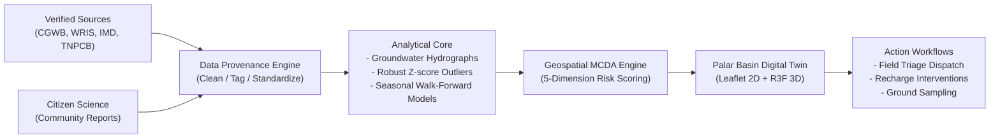

# PALAR GUARD AI

> **"See the Risk. Predict the Change. Protect Every Drop."**

An AI-powered environmental intelligence and water-risk decision platform combining groundwater monitoring, rainfall and recharge analysis, water-quality surveillance, statistical anomaly detection, geospatial risk prioritisation, and community reporting across the **Palar River Basin, Tamil Nadu, India**.

[](https://fastapi.tiangolo.com)
[](https://react.dev)
[](https://tailwindcss.com)
[](https://threejs.org)
[](https://leafletjs.com)
[](LICENSE)

---

## 👥 Project Team & Institution

- **Founder & Project Lead:** Kayalvizhi J
- **Team Members:** Harini S, Aarthi L
- **Institution:** Chennai Institute of Technology, Tamil Nadu, India
- **Target Repository:** [https://github.com/kayalvizhij-2008-it/palar-guard-ai](https://github.com/kayalvizhij-2008-it/palar-guard-ai)

---

## 🌊 Overview & Core Problem

The **Palar River Basin** covers ~17,810 km² across northern Tamil Nadu, supporting agricultural lifelines and vital industrial zones in Tirupathur, Vellore, Ranipet, Kanchipuram, and Chengalpattu.

However, decision-makers and communities face critical challenges:
1. **Accelerated Groundwater Stress:** Intensive seasonal extraction leads to severe aquifer drawdowns (>15 mbgl in summer months).
2. **Fragmented Water Data:** Groundwater levels, rainfall indices, and river quality observations exist in isolated silos across multiple agencies.
3. **Delayed Contamination Triage:** Mineral and heavy metal anomalies (e.g. Total Chromium and high TDS along industrial tannery clusters) require immediate on-ground verification before spreading into municipal wells.
4. **Lack of Explainable Prioritisation:** Local authorities lack a unified, transparent spatial system to triage field investigations.

---

## 🏛️ Architecture & Decision Workflow

PALAR GUARD AI operationalizes the end-to-end workflow:

$$\text{OBSERVE} \longrightarrow \text{ANALYSE} \longrightarrow \text{PREDICT} \longrightarrow \text{PRIORITISE} \longrightarrow \text{VERIFY} \longrightarrow \text{ACT}$$



---

## 📦 16 Core Product Modules

1. **Palar Basin Digital Twin:** Interactive 2D Leaflet & 3D WebGL Digital Twin featuring river reach flowlines, catchment contouring, and 7 continuous baseline stations.
2. **Groundwater Stress Intelligence:** Multi-year quarterly hydrographs tracking depth-to-water (mbgl) and drawdown rates.
3. **Groundwater Forecasting:** Walk-forward seasonal time-series projections with explicit 90% confidence uncertainty intervals.
4. **Rainfall & Recharge Intelligence:** Catchment precipitation series vs 30-year IMD normals; seasonal monsoon distribution tracking (Northeast vs Southwest).
5. **Water Quality Intelligence:** Surveillance of pH, TDS, EC, Total Chromium, BOD, and Dissolved Oxygen benchmarked against BIS 10500 standards.
6. **Pollution Anomaly Detection:** Automated statistical outlier engine using Median Absolute Deviation (MAD) and robust Z-scores.
7. **Geospatial Risk Prioritisation:** Transparent Multi-Criteria Decision Analysis (MCDA) ranking river stretches from 0 to 100.
8. **Data Confidence & Reliability Engine:** Strict provenance classification badges: `[VERIFIED PUBLIC]`, `[HISTORICAL REPORT]`, `[COMMUNITY REPORT]`, `[MODEL PREDICTION]`, and `[SYNTHETIC DEMO]`.
9. **Community Water Reporting:** Citizen incident portal with category geotagging, descriptions, and moderation triage.
10. **Early Warning & Investigation Centre:** Dispatch coordination with interactive field verification checklists and ground notes.
11. **Recharge Intervention Intelligence:** Hydrogeological screening evaluating infiltration capacity for check dams, percolation tanks, and traditional eri desiltation.
12. **PALAR AI Environmental Assistant:** Grounded conversational assistant retrieving verified station facts with zero hallucination.
13. **Analytics & Dossier Reporting Centre:** Custom query filters, direct client-side CSV dataset export, and printable executive dossiers.
14. **Role-Based Access Control (RBAC):** Permissions for Administrator, Environmental Analyst, Field Investigator, Researcher, Community Reporter, and Viewer.
15. **English & Tamil Localization:** Complete bilingual user interface for statewide accessibility.
16. **Administration & Audit Governance:** System health diagnostics and tamper-evident audit logs.

---

## 🧪 Scientific Integrity & Data Provenance

1. **No Fabricated Sensors:** Every baseline coordinate corresponds to verified river stretches in Tamil Nadu (Ranipet, Ambur, Vaniyambadi, Vellore, Walajapet, Kanchipuram, Chengalpattu).
2. **Explicit Uncertainty:** Forecasts state confidence bounds and honest limitations.
3. **Investigation vs Legal Proof:** An anomaly is a statistical signal for field verification, never legal proof of contamination without certified laboratory ICP-MS testing.

---

## 🚀 Getting Started Locally

### Prerequisites
- **Node.js** >= v18.0.0 (v24.x tested)
- **Python** >= 3.10 (3.13 tested)
- **Git**

### 1. Clone the Repository
```bash
git clone https://github.com/kayalvizhij-2008-it/palar-guard-ai.git
cd palar-guard-ai
```

### 2. Backend Setup
```bash
# Navigate to backend
cd backend

# Initialize database with Palar Basin records
python -m app.seed_data

# Start FastAPI development server
uvicorn app.main:app --reload --port 8000
```
Backend will be operational at: `http://localhost:8000` (API Docs at `http://localhost:8000/docs`).

### 3. Frontend Setup
```bash
# In a new terminal, navigate to frontend
cd frontend

# Install dependencies (if not already installed)
npm install

# Run Vite development server
npm run dev
```
Frontend will be available at: `http://localhost:5173`.

### 4. Production Build & Verification
```bash
cd frontend
npm run build
```

---

## 🏛️ Public Reference Sources

- [Central Ground Water Board (CGWB) Palar Aquifer Master Management Plan](https://cgwb.gov.in/sites/default/files/2022-11/aqm_palar_final.pdf)
- [India Water Resources Information System (India-WRIS)](https://indiawris.gov.in/)
- [National Water Informatics Centre (NWIC) / IMD Precipitation Series](https://nwdp.nwic.gov.in/hi/organization/imd)
- [Tamil Nadu Pollution Control Board (TNPCB) River Stretches](https://tnpcb.gov.in/water-quality.php)
- [Central Pollution Control Board (CPCB) Polluted River Criteria](https://www.cpcb.nic.in/wqm/RS-criteria-status.pdf)
- [Springer Research: Hydrogeochemistry in Palar River](https://link.springer.com/article/10.1007/s11356-016-7639-4)

---

## 📄 License

This project is licensed under the MIT License — see the LICENSE file for details. Built for environmental resilience and regional water security across the Palar River Basin.
